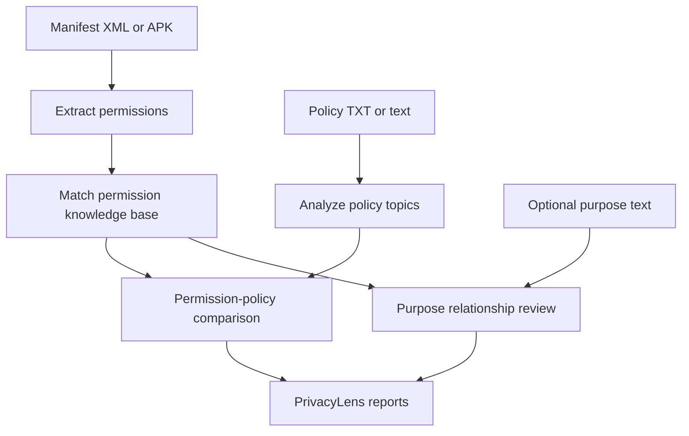

<div align="center">

# PrivacyLens — PS01 Setup Guide

### Android Privacy and Permission Analyzer

A deterministic Streamlit application for reviewing declared Android permissions, supplied privacy-policy evidence, and application-purpose context.

</div>

---

## Overview

PrivacyLens PS01 accepts readable `AndroidManifest.xml` files or Android APK packages. It extracts exact permission declarations, matches recognized permissions to a curated JSON knowledge base, analyzes supplied privacy-policy text, compares evidence, and generates downloadable reports.

The product is intentionally **review-oriented, evidence-led, and conservative**:

- Declarations are not treated as proof of runtime behavior.
- Unknown permissions receive no speculative interpretation.
- Missing policy coverage becomes a transparency gap for review.
- Purpose relationships are questions, not security judgments.

---

## Technology stack

| Component | Technology |
|---|---|
| Interface | Streamlit |
| Processing | Python |
| XML safety | defusedxml |
| APK decoding | androguard 4.1.4 |
| Knowledge base | JSON |
| Data display | pandas |
| Testing | pytest |

No separate backend server, cloud service, external AI API, React application, or JavaScript runtime is required.

---

## Quick start

Run all commands from the repository root.

### 1. Create an environment

```bash
python -m venv .venv
source .venv/bin/activate
```

Windows PowerShell:

```powershell
python -m venv .venv
.venv\Scripts\Activate.ps1
```

### 2. Install dependencies

```bash
python -m pip install -r PS01/requirements.txt
```

### 3. Start PrivacyLens

```bash
streamlit run PS01/frontend/app.py
```

Then open the URL printed by Streamlit, normally `http://localhost:8501`.

---

## Analysis workflow

1. **Choose application evidence**
   - Upload an XML file or select an Android APK.
2. **Provide a privacy policy**
   - Upload UTF-8 `.txt` policy text or paste it directly.
3. **Optionally add application purpose**
   - Add an application name or a short purpose description.
4. **Review results**
   - Inspect permissions, policy evidence, transparency gaps, and purpose relationships.
5. **Generate reports**
   - Download a Markdown report or structured JSON report.



---

## Supported APK behavior

PrivacyLens validates APK input before decoding the manifest:

- Maximum APK size: **50 MB**
- Maximum decompressed manifest size: **10 MB**
- Password-protected archive entries are rejected
- Missing manifests are rejected
- Corrupt or malformed manifest content is reported safely
- Both plaintext and binary Android manifests are supported where decoding succeeds

APK extraction uses Androguard and passes decoded XML to the existing manifest parser.

---

## Project structure

```text
PS01/
├── frontend/
│   └── app.py
├── backend/
│   ├── analyzer/
│   │   ├── apk_extractor.py
│   │   ├── manifest_parser.py
│   │   ├── permission_analyzer.py
│   │   ├── policy_analyzer.py
│   │   ├── app_purpose_analyzer.py
│   │   └── purpose_analyzer.py
│   ├── knowledge_base/
│   │   └── permissions.json
│   ├── reporting/
│   │   └── report_generator.py
│   └── tests/
├── sample_data/
│   └── sample_privacy_policy.txt
├── requirements.txt
└── README.md
```

---

## Interface pages

| Page | Information shown |
|---|---|
| Overview | Current session metrics and workflow status |
| Analysis inputs | Manifest/APK, policy, name, and purpose inputs |
| Permissions | Recognized explanations and unknown identifiers |
| Privacy policy | Topic coverage and supporting excerpts |
| Transparency comparison | Policy coverage, gaps, and unknown statuses |
| Purpose review | Relationship evidence and review classifications |
| Reports | Markdown and JSON report downloads |

---

## Run the full test suite

```bash
python -m pytest PS01/backend/tests -q
```

Current coverage includes:

- Safe XML parsing and namespace handling
- Duplicate and empty permission declarations
- APK validation and binary manifest extraction
- Known and unknown permission matching
- Policy topic and excerpt grounding
- Permission-policy comparisons
- Purpose relationship classifications
- Markdown and JSON report generation

---

## Privacy and security limitations

PrivacyLens does not:

- Install or execute applications
- Scan an Android device
- Observe runtime network traffic
- Inspect hidden application behavior
- Verify that a privacy policy is complete or truthful
- Prove malicious intent or confirm compliance

A supplied policy is analyzed only for deterministic topic and excerpt coverage. Purpose comparison uses the user's description and curated permission mappings. Both remain review aids rather than factual evidence of application behavior.

---

## Reports

### Markdown

A human-readable evidence-linked report containing:

- Application information
- Extracted permission identifiers
- Recognized permission explanations
- Unknown permissions
- Privacy-policy findings
- Transparency comparisons
- Purpose-review results
- Limitations and evidence boundaries

### JSON

A structured machine-readable report containing the actual session analyzer results for downstream processing or inspection.

Reports should be regenerated after new inputs are analyzed. They contain only the current session's completed analysis state.

---

<div align="center">

[Back to project overview](../README.md) · [Problem statement](../PS01.md) · [Phase 1 roadmap](../Advanced.txt)

</div>
