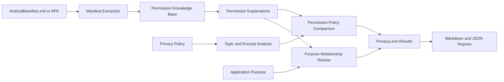

<div align="center">

# 🔐 PrivacyLens

### See what Android apps can access. Understand what privacy policies disclose.

[](https://www.python.org/)
[](https://streamlit.io/)
[](https://developer.android.com/)
[](https://github.com/)

**PrivacyLens is an explainable privacy analysis workspace for Android manifests and privacy policies.**
It extracts declared permissions, explains known capabilities, highlights unknown declarations, compares policy coverage, and creates traceable reports.

</div>

---

## ✨ What PrivacyLens does

<table>
<tr>
<td width="50%">

### 📱 Analyze Android applications

- Upload a readable `AndroidManifest.xml`
- Upload and inspect an APK safely
- Extract unique permission declarations
- Preserve exact Android permission identifiers

</td>
<td width="50%">

### 🧠 Explain privacy implications

- Match permissions against a curated knowledge base
- Explain capabilities and protection levels
- Flag unknown permissions without guessing
- Keep declarations separate from runtime behavior

</td>
</tr>
<tr>
<td width="50%">

### 📄 Review privacy policies

- Upload TXT policy documents
- Paste policy text directly
- Identify relevant privacy topics
- Preserve supporting excerpts as evidence

</td>
<td width="50%">

### 📊 Generate transparent reports

- Compare permissions with policy coverage
- Compare permissions with stated application purpose
- Export readable Markdown reports
- Export structured JSON reports

</td>
</tr>
</table>

> PrivacyLens is an evidence-led review tool. Declared permissions do **not** prove that an application collected, accessed, stored, or transmitted data. Missing policy statements are transparency gaps, not proof of wrongdoing.

---

## 🧭 Analysis workflow



---

## 🚀 Quick start

### 1. Clone and enter the repository

```bash
git clone <repository-url>
cd Archithon
```

### 2. Create a virtual environment

```bash
python -m venv .venv
source .venv/bin/activate
```

On Windows:

```powershell
python -m venv .venv
.venv\Scripts\activate
```

### 3. Install PrivacyLens

```bash
python -m pip install -r PS01/requirements.txt
```

### 4. Launch the dashboard

```bash
streamlit run PS01/frontend/app.py
```

Open the local URL shown by Streamlit, normally `http://localhost:8501`.

---

## 🖥️ PrivacyLens interface

| Page | Purpose |
|---|---|
| **Overview** | Session metrics, workflow, and analysis status |
| **Analysis inputs** | Manifest/APK upload, policy input, and stated purpose |
| **Permissions** | Recognized and unknown permission explanations |
| **Privacy policy** | Deterministic topic findings and source excerpts |
| **Transparency comparison** | Policy coverage and missing-statement review |
| **Purpose review** | Evidence-limited relationship assessment |
| **Reports** | Markdown and JSON downloads |

---

## 📂 Project structure

```text
Archithon/
├── PS01/
│   ├── frontend/
│   │   └── app.py                 # Streamlit PrivacyLens interface
│   ├── backend/
│   │   ├── analyzer/              # Manifest, policy, purpose, and APK engines
│   │   ├── knowledge_base/        # Curated Android permission knowledge
│   │   ├── reporting/             # Markdown and JSON report generation
│   │   └── tests/                 # Automated test suite
│   ├── sample_data/
│   ├── requirements.txt
│   └── README.md
├── PS01.md                        # Original problem statement
├── Advanced.txt                   # PrivacyLens Phase 1 roadmap
└── README.md
```

---

## 🧪 Run the tests

```bash
python -m pytest PS01/backend/tests -q
```

Tests cover manifest extraction, APK decoding and validation, permission matching, policy analysis, purpose comparison, report generation, and analysis safety boundaries.

---

## 🛡️ Privacy and evidence boundaries

PrivacyLens is intentionally conservative:

- Unknown permissions are preserved exactly and never assigned speculative explanations.
- Policy excerpts come from user-supplied policy text.
- Purpose relationships are review questions, not behavioral conclusions.
- Missing disclosures indicate review priorities, not wrongdoing.
- The application does not execute APK code, install apps, scan devices, or observe runtime behavior.

For operational and security details, see the [PS01 documentation](PS01/README.md).

---

<div align="center">

### PrivacyLens

**Make permission declarations understandable. Keep every conclusion evidence-led.**

[Launch PrivacyLens](PS01/README.md#quick-start) · [View PS01 Specification](PS01.md) · [Review Phase 1 Roadmap](Advanced.txt)

</div>
